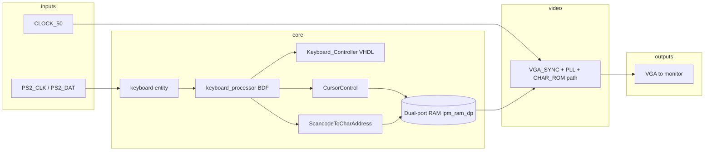
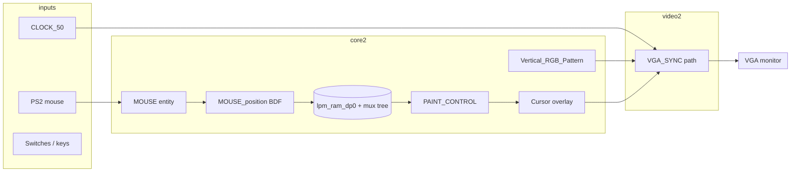

# FPGA Text and Graphic Editors on the Terasic DE2  
**Course / student name / date — fill in before PDF export**

> **How to get ~10 pages in PDF**  
> 1. Paste your **screenshots** where indicated (Quartus: full BDF zoomed out; zoom on PS/2 + VGA areas; successful compile; Programmer window; board + monitor photo).  
> 2. Export this file to PDF (VS Code / Typora / Pandoc, or paste into Word).  
> 3. Adjust font (11–12 pt) and margins so total length is **about 8–10 pages** with figures.

**Important:** Write in your own words what **you** designed, integrated, and tested. If you started from public or lab code, state that where your course requires it. Identical hardware with renamed files is still the same logic.

---

## Abstract

This report describes two Cyclone II FPGA designs for the Terasic DE2 board: (1) a **PS/2 keyboard-driven text terminal** with VGA output, and (2) a **PS/2 mouse-driven graphic paint** application with VGA output. Both systems use a **top-level BDF schematic** for system integration, **VHDL modules** for control and decoding, and **Quartus megafunctions** for memories and multiplexers. The document summarizes architecture, primary modules, tool flow, and hardware demonstration.

---

## 1. Introduction and objectives

Modern digital systems courses use FPGAs to teach **interface design**: clocks, synchronous state machines, external buses, and video timing. The DE2 board provides **50 MHz clock**, **PS/2** ports, and **VGA** output.

**Objectives**

1. Receive **PS/2 scan codes** and display **alphanumeric text** on a VGA monitor.  
2. Receive **PS/2 mouse** motion and buttons and **paint** or **erase** pixels in a framebuffer displayed over VGA.  
3. Practice **Quartus II** flow: compile, timing, and **SRAM programming** (`.sof`).

---

## 2. Target hardware and tools

- **Board:** Terasic DE2 (Altera Cyclone II `EP2C35F672C6`).  
- **IDE:** Intel/Altera **Quartus II** (version as per lab; device family **Cyclone II**).  
- **Cable:** USB-Blaster for configuration.  
- **Peripherals:** VGA monitor, PS/2 keyboard (project 1), PS/2 mouse (project 2).

**[PLACE SCREENSHOT HERE — Fig. 1]**  
*Caption: Quartus window showing opened project `de2_text_editor_lab.qpf` or `de2_graphic_editor_lab.qpf` with device EP2C35F672C6.*

---

## 3. System overview — text editor

### 3.1 Block diagram (conceptual)

### 3.2 Signal flow (one paragraph)

The **PS/2 keyboard** delivers serial data decoded into **8-bit scan codes**. A controller **FSM** (`Keyboard_Controller`) cooperates with **`scan_ready`** and **`read`** to capture one key event at a time. **`ScancodeToCharAddress`** translates the scan code into a **6-bit character index** for the font. **`CursorControl`** maintains **row/column** and a **write address** into **dual-port RAM** that stores the screen characters. The **VGA** block reads the same memory using addresses derived from the **current pixel position** (`ReadAddress` style logic), fetches a **bitmap** from **CHAR_ROM**, and modulates **RGB** for each pixel.

### 3.3 Top-level BDF — text project

The file **`de2_text_editor_top.bdf`** is the **root schematic**. It exposes DE2 pins (`CLOCK_50`, `KEY`, `SW`, `PS2_*`, `VGA_*`, `LEDR`, …) and instantiates:

- **`keyboard_processor.bdf`** — datapath between PS/2 and memory.  
- **`VGA_SYNC`** (and related blocks from `de2_board_ip`) — video timing and character rendering.

**[PLACE SCREENSHOT HERE — Fig. 2]**  
*Caption: Full view of `de2_text_editor_top.bdf` (fit to page width in PDF).*

**[PLACE SCREENSHOT HERE — Fig. 3]**  
*Caption: Zoomed region showing PS/2 keyboard connection and wires into `keyboard_processor`.*

**[PLACE SCREENSHOT HERE — Fig. 4]**  
*Caption: Zoomed region showing VGA_SYNC / video outputs.*

---

## 4. Module-level description — text editor

### 4.1 `ScancodeToCharAddress`

Combinational logic: **input** `scan_code`, **output** `char_address`. Maps supported keys (A–Z, 0–9, space, punctuation) to **ROM indices**. Default output is **blank** for unknown codes.

### 4.2 `Keyboard_Controller`

Synchronous FSM using **`scan_ready`** and **`scan_code`**. Recognizes **break** prefixes (`F0`, `E0`) to distinguish press vs release sequences. Produces **`read`** / **`wren`** pulses for safe capture.

### 4.3 `CursorControl`

Sequential process on **`rising_edge(wren)`** with asynchronous **`reset`**. Implements **grid cursor**: Enter increments row; Backspace moves back; arrows move within **40×N** grid; computes **`w_addr`** for RAM writes.

### 4.4 `ReadAddress`

Computes **linear framebuffer address** from pixel row/column (upper bits), e.g. `row * 40 + col`, for **read side** during video refresh.

### 4.5 Megafunctions (`lpm_ram_dp*`, `lpm_mux*`, `lpm_ff*`)

**Dual-port RAM** stores the character buffer; **muxes** select between write data, read data, and VGA path; **FFs** hold state and registered buses. These files are **tool-generated**; parameters were chosen in MegaWizard (width, depth, ports).

---

## 5. System overview — graphic editor

### 5.1 Block diagram (conceptual)

### 5.2 Behaviour summary

The mouse reports **row/column** of the pointer. **Left/right buttons** choose **draw** or **erase** at the current cell. **`PAINT_CONTROL`** compares current pixel index to mouse index and writes colour into the memory/mux path. **`Cursor`** highlights the pointer. **`Name_Address`** can paint a **fixed text banner** in a reserved screen strip. **`Vertical_RGB_Pattern`** supplies **test patterns** during integration.

### 5.3 Top-level BDF — graphic project

File **`de2_graphic_editor_top.bdf`** connects **mouse**, **RAM/mux IP**, **pattern generator**, **VGA_SYNC**, switches, and VGA pins.

**[PLACE SCREENSHOT HERE — Fig. 5]**  
*Caption: Full `de2_graphic_editor_top.bdf` schematic.*

**[PLACE SCREENSHOT HERE — Fig. 6]**  
*Caption: Mouse + RAM region.*

**[PLACE SCREENSHOT HERE — Fig. 7]**  
*Caption: VGA outputs from top sheet.*

---

## 6. Implementation and tool flow

1. **Create / open project** — `.qpf` selects revision; `.qsf` lists **VHDL_FILE**, **BDF_FILE**, **QIP_FILE**, **device**, **pins**, **SEARCH_PATH**.  
2. **Analysis & Synthesis** — VHDL + BDF → gate-level netlist.  
3. **Fitter** — places logic in LABs, routes to pins.  
4. **Assembler** — generates `.sof`.  
5. **Programmer** — downloads `.sof` to FPGA SRAM configuration.

**[PLACE SCREENSHOT HERE — Fig. 8]**  
*Caption: Successful compilation flow (green checkmarks) for one project.*

**[PLACE SCREENSHOT HERE — Fig. 9]**  
*Caption: Programmer window showing USB-Blaster and `.sof` programmed.*

---

## 7. Hardware demonstration

Describe what a **video** or **photo** should show:

- **Text project:** typing visible on VGA; Enter/Backspace/arrow behaviour.  
- **Graphic project:** cursor moves; left button paints; right button erases (or per your actual switch mapping — verify on board).

**[PLACE PHOTO HERE — Fig. 10]**  
*Caption: DE2 connected to VGA monitor (and keyboard or mouse) showing working application.*

---

## 8. Legacy Portuguese `report.txt` (what it was)

The old **`report.txt`** (removed from the cleaned English submission tree) was a **Portuguese-language lab note**, not part of the FPGA bitstream. In English it mainly said:

- Each key has a **make code** when pressed; holding a key repeats the make code.  
- **Break codes** indicate release, often `F0` + make code.  
- The **`keyboard`** block waits for a key, then uses **`read`** and **`scan_ready`** as a **handshake** so the host reads each scan code once.

Your formal report should be **entirely in English** (or the language required by your instructor).

---

## 9. Risks, limitations, and future work

- **PS/2 timing** is sensitive; long cables or poor connectors cause missed bits.  
- **Resolution and font** are fixed by `VGA_SYNC` / ROM design.  
- **Future work:** UART logging, on-screen settings menu, SDRAM framebuffer for higher resolution.

---

## 10. Conclusion

Both designs integrate **PS/2 input**, **on-chip memory**, and **VGA output** under Quartus II on the Cyclone II DE2. The **top-level BDF** documents system wiring; **VHDL modules** implement decoding and cursor/paint control; **megafunctions** implement memories and routing. Successful **compilation** and **hardware demo** verify end-to-end behaviour.

---

## References (fill as required)

1. Terasic DE2 user manual — pinout and clock.  
2. Intel Quartus II documentation — Cyclone II handbook.  
3. PS/2 keyboard/mouse protocol summaries used for your understanding (cite if allowed).
